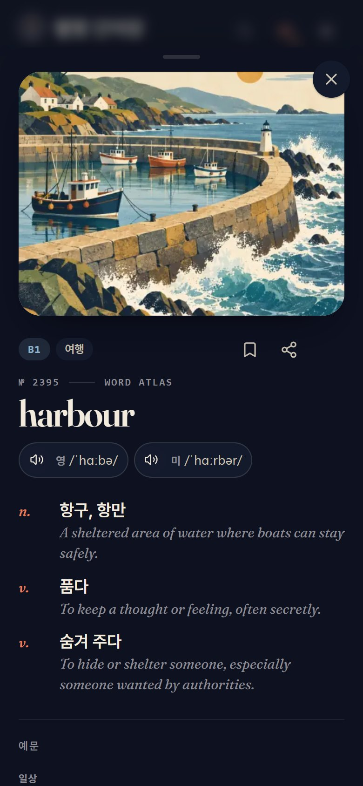
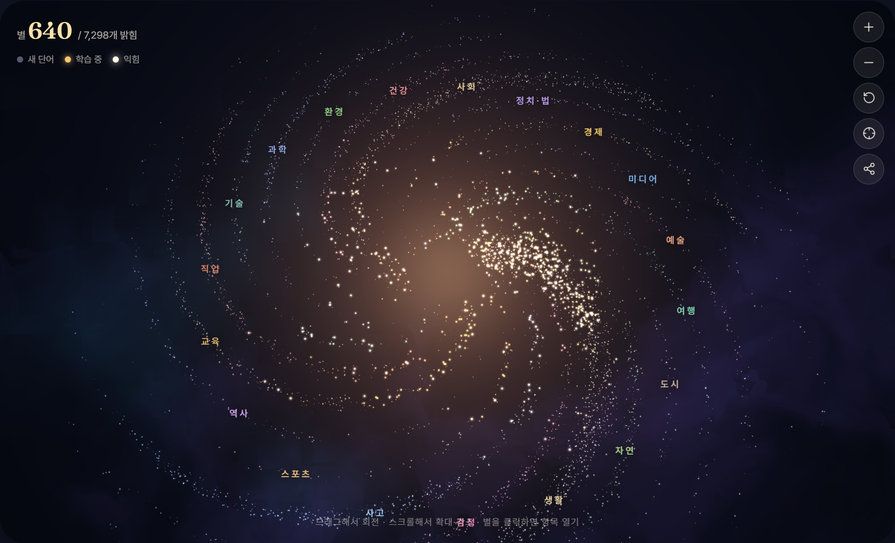

# 별빛 단어장 · Word Atlas 한국어판

[Word Atlas(词光)](https://github.com/designfuchen/word-atlas)를 한국어 학습자용으로 옮긴 IELTS 단어장입니다. 

- **원본:** Word Atlas contributors — 코드 [MIT](LICENSE), 단어 데이터·일러스트·녹음 [CC BY 4.0](https://creativecommons.org/licenses/by/4.0/)
- **바꾼 내용:** 단어 7,298개의 뜻·예문 번역·연어·팁·주의 문구와 앱 화면을 한국어로 옮겼습니다. 번역은 Claude Opus 5.5로 했고 항목마다 사람이 검토하지는 않았습니다. 자세한 내용과 한국어 번역의 라이선스(CC BY 4.0)는 [CONTENT_LICENSE.md](CONTENT_LICENSE.md)에 있습니다.
- 틀린 번역을 발견하면 이 저장소에 Issue를 남겨 주십시오. 원본 저장소가 아니라 여기로 알려 주시면 감사하겠습니다.
원작자가 아닌 개인이 따로 만든 것이라, 원작자는 한국어 번역 작업에 참여하거나 검토하지 않았습니다. 한국어판에 관한 문의와 책임은 이 저장소에 있습니다.

[中文原版 README](README.zh-CN.md) · [English README](README.en.md)

---

<div align="center">

**단어를 그림으로 바꾸고, 복습에 길잡이를 더합니다.**

IELTS 단어 7,298개 · 오리지널 일러스트 · 영국·미국 발음 · FSRS 간격 복습

[**바로 써 보기 ↗**](https://gyumin0405.github.io/word-atlas-korean/)　 /　 [단어 데이터 내려받기](data/)

[](LICENSE)
[](CONTENT_LICENSE.md)

</div>

별빛 단어장은 일러스트와 문맥을 중심으로 IELTS 단어를 익히는 앱입니다. 그림으로 뜻을 이해하고, 발음을 들으며 연결하고, 떠올리기와 간격 복습으로 기억을 굳힙니다. 계정이 필요 없으며, 학습 기록은 사용자의 기기에만 저장됩니다.

[미리 보기](#미리-보기) · [학습 방식](#학습-방식) · [로컬에서 실행하기](#로컬에서-실행하기) · [공개 데이터](#공개-데이터) · [기여하기](#기여하기)

## 미리 보기

### 듣고 연습할 수 있는 단어 도감


<table>
<tr>
<td width="50%"></td>
<td width="50%"></td>
</tr>
<tr><td align="center">오늘의 계획에 집중하기</td><td align="center">그림, 뜻, 발음을 카드 한 장에</td></tr>
</table>

<sub>이 저장소의 실제 화면입니다.</sub>

### 익힌 단어가 나만의 별자리가 됩니다



19개 주제가 하나의 단어 별자리를 이룹니다. 드래그해서 돌리고, 스크롤해서 확대하고, 별을 누르면 단어 카드가 열립니다. 학습 상태는 별의 밝기로 나타냅니다. WebGL2로 렌더링하며, 지원하지 않는 기기에서는 간단한 화면으로 대신 보여 줍니다.

## 학습 방식

| 단계 | 하는 일 |
| :--- | :--- |
| **보기** | 단어마다 일러스트 한 장, 영어·한국어 뜻, 오리지널 예문 두 개, 자주 쓰는 표현, 파생어, 팁이 있습니다. |
| **듣기** | 영국·미국 발음을 바꿔 가며 듣고, 일상 예문 낭독을 듣습니다. 일부 단어는 두 번째 예문 녹음도 있습니다. |
| **떠올리기** | 뜻 보고 단어 고르기, 그림 보고 빈칸 채우기, 듣고 단어 고르기, 철자 쓰기로 능동적으로 떠올립니다. |
| **복습** | FSRS가 학습 기록에 맞춰 복습 시점을 정합니다. 목표 기억률은 조절할 수 있으며, 정답률에는 첫 번째 답만 반영됩니다. |
| **쌓기** | 별자리 지도로 진행 상황을 확인하고, 타자 연습은 따로 기록됩니다. 학습 기록을 내보내고 복원할 수 있습니다. |

**기기 우선 저장.** 가입이 필요 없으며, 열어 본 단어와 미디어는 캐시에 저장되어 오프라인에서도 볼 수 있습니다. 기기를 바꾸기 전에는 학습 기록을 먼저 내보내 주십시오.

<details>
<summary><b>발음과 예문 녹음 들어 보기</b></summary>

*abandon*을 예로 들면 다음과 같습니다.

| | |
|---|---|
| 🇬🇧 영국 발음 | [abandon /əˈbændən/](public/atlas/audio/uk/abandon.mp3) |
| 🇺🇸 미국 발음 | [abandon /əˈbændən/](public/atlas/audio/us/abandon.mp3) |
| 📖 예문 낭독 | [We had to abandon our car in the snow.](public/atlas/audio/ex/abandon.mp3) |

단어 7,298개 모두 영국·미국 발음과 예문 녹음이 있으며, 중요 단어 1,011개는 두 번째 예문 녹음도 있습니다.

배경음 7가지(별밤 음악, 비 오는 도서관, 새벽 바닷가, 숲속의 아침, 밤의 벽난로, 항해하는 선실, 조용한 카페)와 정답·오답·카드 넘김·연속 정답 같은 효과음도 들어 있습니다. 단어를 읽어 줄 때는 배경음이 자동으로 작아집니다.

일러스트는 `public/atlas/img/`, 녹음은 `public/atlas/audio/`에 있고 CC BY 4.0으로 공개됩니다. 화면 효과음과 배경음은 `public/sfx/`에 있으며 앱과 함께 제공됩니다.

</details>

## 로컬에서 실행하기

**Node.js 20 이상**과 npm이 필요합니다. 이미지와 녹음이 모두 들어 있어 처음 내려받는 데 시간이 걸릴 수 있습니다.

```bash
git clone --depth 1 https://github.com/gyumin0405/word-atlas-korean.git
cd word-atlas-korean
npm ci
npm run dev
```

**http://localhost:5188**을 엽니다.

```bash
npm test             # 단위 테스트
npm run check:atlas  # 단어 데이터 구조와 미디어 검사
npm run build        # dist/로 빌드
```

하위 경로에 배포하려면 `ATLAS_BASE=/words/ npm run build`처럼 빌드합니다. 자세한 내용은 [배포 문서](docs/deployment.md)를 참고하십시오.

**기술 스택:** React 19 · TypeScript · Vite · ts-fsrs · WebGL2

## 공개 데이터

앱으로 쓰는 것 외에도, 단어 데이터를 직접 만든 학습 도구나 Anki 덱, 연구에 활용할 수 있습니다.

| 자료 | 내용 | 위치 |
| :--- | :--- | :--- |
| 단어 | **7,298**개, CEFR A1–C2, 주제 19개 | [JSON](data/word-atlas.json) · [CSV](data/word-atlas.csv) |
| 예문 | **14,596**개, 일상·IELTS 문맥, 한국어 번역 포함 | [필드 설명](docs/dataset.md) |
| 일러스트 | **7,298**장, 512px WebP와 썸네일 | [이미지 폴더](public/atlas/img/) |
| 녹음 | **22,905**개, 영국·미국 발음과 예문 읽어 주기 | [오디오 폴더](public/atlas/audio/) |

```python
import json
from pathlib import Path

words = json.loads(Path("data/word-atlas.json").read_text(encoding="utf-8"))
b2_environment = [w for w in words if w["cefr"] == "B2" and w["topic"] == "environment"]
```

<details>
<summary><b>단어 항목 하나의 데이터 구조</b></summary>

필드 이름은 원본 앱과 호환되도록 `zh`를 그대로 쓰지만, 내용은 한국어입니다. CSV에서는 `meanings_ko`, `example1_ko`처럼 열 이름을 바꿨습니다.

```json
{
  "id": "principle",
  "w": "principle",
  "uk": "/ˈprɪnsəpəl/",
  "us": "/ˈprɪnsəpəl/",
  "senses": [{ "pos": "n.", "zh": "원칙, 신념", "en": "A belief or rule that guides decisions and behaviour." }],
  "ex": [
    { "en": "I refused the extra money as a matter of principle.", "zh": "나는 원칙의 문제라서 추가 금액을 거절했다." },
    { "en": "The principle of equal opportunity should guide policies designed to improve access to higher education.", "zh": "기회 균등의 원칙은 고등 교육 접근성을 높이기 위한 정책의 지침이 되어야 한다." }
  ],
  "col": ["basic principle｜기본 원칙", "in principle｜원칙적으로"],
  "fam": ["principled (adj.)"],
  "tip": "principal(주요한, 교장)과 철자·뜻을 혼동하지 않도록 주의하자.",
  "cefr": "B2",
  "topic": "thinking"
}
```

</details>

### 콘텐츠 출처와 한계

원본의 뜻, 예문, 일러스트, 녹음은 원 프로젝트에서 만든 것입니다. 글과 그림은 생성형 AI로, 음성은 ElevenLabs로 만들었습니다. 한국어 번역은 Claude Opus 5.5로 했습니다. 구조와 일관성은 자동으로 검사했지만 **항목마다 사람이 검토하지는 않았습니다.** 뜻, 예문, 일러스트, 발음에 오류가 있을 수 있습니다. IELTS 공식 단어 목록이 아니며 점수 향상을 보장하지도 않습니다.

[콘텐츠 생성 과정](docs/pipeline.md) · [기억 모델](docs/learning-model.md) · [생성 스크립트](scripts/atlas/) · [한국어 번역 스크립트](scripts/ko/)

## 기여하기

문제를 알려 주실 때는 **단어 ID, 재현 방법, 기대한 결과**를 함께 적어 주십시오. 내용을 고칠 때 사전 등 근거가 있다면 함께 알려 주시면 감사하겠습니다.

- **한국어 번역·화면 문구 오류:** [이 저장소에 Issue 남기기](https://github.com/gyumin0405/word-atlas-korean/issues/new)
- **영어 원문·일러스트·발음 오류:** 원본 [designfuchen/word-atlas](https://github.com/designfuchen/word-atlas/issues)에 알려 주십시오.
- [기여 안내](CONTRIBUTING.md) · [보안 정책](SECURITY.md)

## 라이선스

| 범위 | 라이선스 |
| :--- | :--- |
| 앱 코드 | [MIT](LICENSE) |
| 단어 데이터, 일러스트, 녹음 | [CC BY 4.0](CONTENT_LICENSE.md), 저작자 표시 Word Atlas contributors(词光) |
| 한국어 번역과 수정 | [CC BY 4.0](CONTENT_LICENSE.md), 저작자 표시 gyumin0405 |
| 외부 의존성과 글꼴 | 각각의 라이선스를 따릅니다 |

---

원작 Word Atlas는 [@designfuchen](https://github.com/designfuchen)이 만들었습니다.
